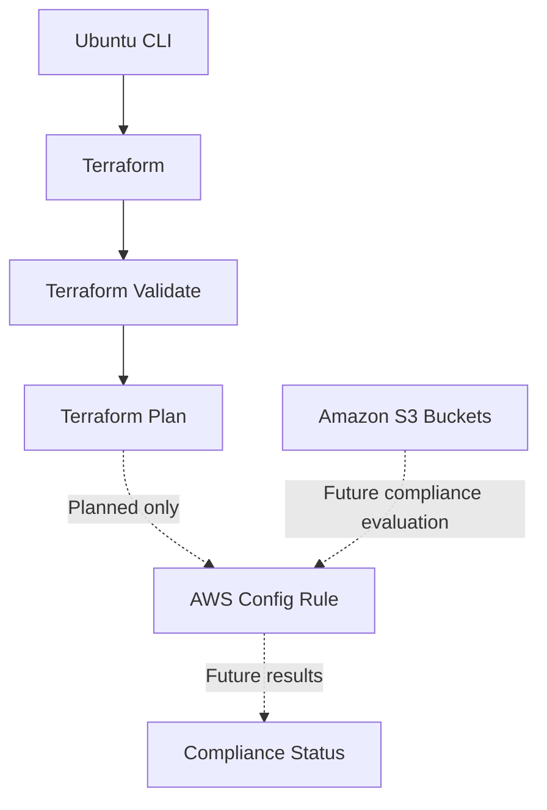
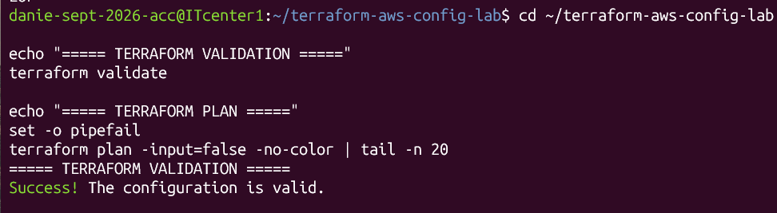

# AWS Config Terraform Lab

## Project Status

**PLAN ONLY — No AWS resources deployed by this project.**

## Project Overview

This project demonstrates how to define an AWS Config compliance rule using Terraform.

The proposed rule checks whether Amazon S3 buckets have server-side encryption enabled.

This project is part of Module 10: Management & Governance in my AWS Cloud Engineering portfolio.

## Architecture



The diagram illustrates the planned workflow. It does not represent deployed infrastructure.

## Technology Stack

- AWS Config
- Amazon S3
- Terraform
- AWS CLI
- Ubuntu Linux
- Git and GitHub

## Planned Terraform Resource

| Resource | Purpose | Status |
|---|---|---|
| AWS Config Rule | Check S3 bucket server-side encryption | Planned only |

### Configuration Details

- AWS Region: `us-east-1`
- Rule name: `terraform-s3-bucket-encryption-check`
- Rule identifier: `S3_BUCKET_SERVER_SIDE_ENCRYPTION_ENABLED`
- Resource scope: `AWS::S3::Bucket`

## Existing AWS Environment Discovery

Read-only AWS CLI checks identified:

- An existing configuration recorder named `default`
- Recorder status: stopped
- An existing delivery channel named `default`
- A configured delivery bucket: `config-bucket-774305591665`
- The bucket was absent from the account's S3 bucket listing
- A direct S3 HeadBucket request returned HTTP 404
- 330 existing AWS Config rules

Many existing rules are managed by AWS Security Hub.

These resources were discovered, not created by this Terraform project.

## Terraform Validation

Commands:

```bash
terraform init
terraform fmt
terraform validate
terraform plan -input=false -no-color
```

Observed results:

- Terraform validation succeeded.
- Terraform plan succeeded.
- Plan: 1 to add, 0 to change, 0 to destroy.

No Terraform apply was executed.

## Validation Evidence

See [Validation Evidence](docs/validation-evidence.md).



## Security Considerations

- Do not commit AWS credentials or private keys.
- Do not commit Terraform state files.
- Do not modify existing Security Hub-managed Config rules.
- Do not start the existing recorder without authorization.
- Do not recreate or modify the existing delivery bucket without investigation.
- Use least-privilege IAM permissions.

## Cost Considerations

AWS Config recording and compliance evaluations can incur charges.

This project remains in PLAN ONLY mode to avoid deploying additional chargeable resources.

## Future Improvements

- Investigate the existing AWS Config delivery bucket configuration.
- Review recorder permissions and configuration.
- Evaluate compliance findings in an authorized environment.
- Consider Terraform import for existing resources only after reviewing ownership and state-management implications.

## Project Outcome

Successfully created and validated a Terraform configuration that proposes one AWS Config compliance rule without deploying or modifying existing AWS resources.
